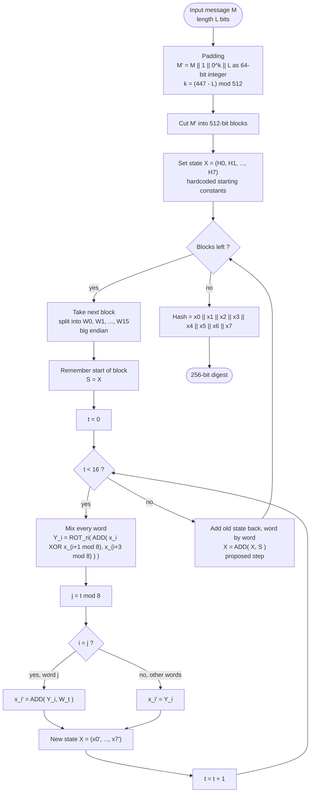

# SHAring-256

A hash function takes a message of any length and squeezes it into a fixed-size fingerprint. This one produces a **256-bit** fingerprint (eight 32-bit words). It works in rounds, mixing the message into eight state words using only three simple operations: add, XOR and rotate.

## Quick facts

| Setting | Value |
| --- | --- |
| Word size | 32 bits |
| Modulus Q | 2^32 |
| Block size | 512 bits (16 words) |
| State | 8 words, x0 to x7 |
| Rounds per block | 16 |
| Byte order | Big endian |
| Output | 256 bits |

## The three building blocks

**ADD(a, b)** adds two numbers and wraps around at 2^32, so the result always fits in 32 bits.

```
ADD(a, b) = (a + b) mod Q        where Q = 2^32
```

**XOR** (written as ⊕) compares two words bit by bit. The result bit is 1 when the two input bits differ.

**ROT_r(x)** rotates the bits of a 32-bit word to the right by r places. Bits that fall off the right end come back in on the left, so nothing is lost.

```
ROT_r(x) = (x >> r) OR (x << (32 - r))
```

A small example using 8 bits instead of 32 so it fits on one line: rotating `10110001` right by 3 gives `00110110`. The last three bits (`001`) moved to the front.

## Step 1: Padding

The message M has length L bits. Before hashing, it is padded so its total length is an exact multiple of 512 bits.

```
M' = M, then a single 1 bit, then k zero bits, then L as a 64-bit number
k  = (447 - L) mod 512
```

Check with the 3-letter message "abc", where L = 24: k = (447 - 24) mod 512 = 423. Total length = 24 + 1 + 423 + 64 = 512 bits, exactly one block.

The 64-bit length is written big endian.

## Step 2: Split into words

Each 512-bit block of M' is cut into 16 words of 32 bits each, read big endian:

```
W0, W1, W2, ..., W15
```

## Step 3: Starting state

The state is eight words:

```
X(0) = (H0, H1, H2, H3, H4, H5, H6, H7)
```

H0 to H7 are fixed constants of your own choosing, hardcoded in the program. They are the starting point for the very first block.

## Step 4: The 16 rounds

At round t, the current state is X(t) = (x0, x1, ..., x7).

**Part A: mix every word.** For each word i from 0 to 7, take its own value, XOR it with the next word, add the word three places ahead, then rotate. Indexes wrap around, so after x7 comes x0 again.

```
Y_i = ROT_ri( ADD( x_i XOR x_((i+1) mod 8), x_((i+3) mod 8) ) )
```

Every Y_i uses the old state from the start of the round. Nothing is partly updated.

Who each word looks at:

| i | uses x_i with | adds | rotates by r_i (proposed) |
| --- | --- | --- | --- |
| 0 | x1 | x3 | 3 |
| 1 | x2 | x4 | 5 |
| 2 | x3 | x5 | 7 |
| 3 | x4 | x6 | 11 |
| 4 | x5 | x7 | 13 |
| 5 | x6 | x0 | 17 |
| 6 | x7 | x1 | 19 |
| 7 | x0 | x2 | 23 |

**Part B: feed in one message word.** Pick which state word gets the message this round:

```
j = t mod 8
x_i' = ADD(Y_i, W_t)     if i = j
x_i' = Y_i               if i is not j
```

So only one state word per round receives message data. Over 16 rounds, each message word W0 to W15 is used exactly once. State word j receives W_j in the first 8 rounds and W_(j+8) in the last 8.

**Part C: new state.**

```
X(t+1) = (x0', x1', x2', x3', x4', x5', x6', x7')
```

## Step 5: Finishing a block and handling long messages

After round 16 the state is X(16). If the message is longer than one block, the state carries over and becomes the starting state for the next block.

**Proposed:** before moving on, add the block's starting state back in, word by word, mod 2^32. This "add the old state back" step makes each block a one-way step, so it is harder to work backwards from a known hash. For a one-block message, the old state is simply H0 to H7.

## Step 6: Output

When all blocks are done, join the eight final state words:

```
Hash = x0, x1, x2, x3, x4, x5, x6, x7     (8 words x 32 bits = 256 bits)
```

## Flowchart



## Status of the design

**Confirmed**
- Word size, modulus, padding rule, 16 rounds, the round formula and the output layout
- Starting constants H0 to H7 are your own and hardcoded
- Big endian for words and the length field
- State carries over between blocks

**Proposed, waiting for a yes or no**
- Rotation amounts 3, 5, 7, 11, 13, 17, 19, 23
- Adding the old state back at the end of each block
- Adding W_t in round t (the handwriting was a little smudged)

**Still open**
- The actual values of H0 to H7

## Worth knowing

- **Length extension.** Because the output is the entire final state, anyone who knows a hash can keep hashing more data on top of it without knowing the original message. SHA-256 has the same property. It does not matter for learning, but it matters if the hash is ever used to check secret keys.
- **Test the mixing.** Flip one bit of the input and count how many of the 256 output bits change. A good result is close to 128, every time.
- **Learning, not security.** A home-made hash is a great way to learn, but real security needs years of review by experts.